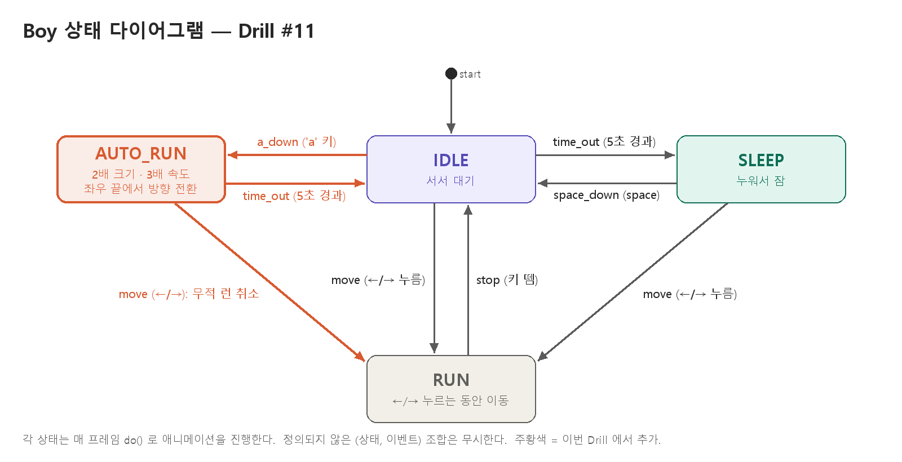

# PRD — Drill #11. 소년 자동 무적 런(AutoRun) 상태 추가

## 1. 개요

LEC12 캐릭터 컨트롤러 실습의 소년(Boy) 상태 머신(IDLE / SLEEP / RUN)에
**자동 무적 런(AUTO_RUN)** 상태를 추가한다.
상태 머신은 `transitions` 라이브러리로 구성하고, 각 상태의 동작은 **상태 클래스**로 구현한다.

- 언어 / 라이브러리: Python 3, `pico2d`, `transitions`
- 실행: `python main.py`

## 2. 요구사항

| ID | 요구사항 | 채점 |
|----|----------|------|
| R1 | IDLE 상태에서 `a` 키를 누르면 AUTO_RUN 상태가 되어, 키 조작 없이도 계속 좌우로 이동한다. | 1점 |
| R2 | AUTO_RUN 상태에서 5초 이상 지나면 IDLE 상태로 돌아간다. | 1점 |
| R3 | AUTO_RUN 상태에서 소년의 속도가 빨라지고 크기가 커진다. | 1점 |
| R4 | AUTO_RUN 상태에서 화면 좌우 끝에 닿으면 자동으로 방향을 바꾼다. | 1점 |
| R5 | AUTO_RUN 상태에서 방향키를 누르면 무적 런이 취소되고, 누른 방향으로 움직이는 RUN 상태가 된다. | - |
| R6 | 반드시 `AutoRun` 상태 클래스를 추가해서 구현한다. | 필수 |
| R7 | 상태 다이어그램 이미지를 저장소에 포함한다. | 1점 |

## 3. 기존 동작 (LEC12 실습에서 가져옴)

- IDLE: 서서 대기 애니메이션. 5초 동안 아무 입력이 없으면 SLEEP.
- SLEEP: 누워서 자는 애니메이션. `space` → IDLE, 방향키 → RUN.
- RUN: 방향키를 누르는 동안 좌우 이동. 키를 떼면 IDLE. 화면 밖으로 나가지 않는다.

## 4. 설계

### 4.1 상태 클래스

각 상태는 같은 인터페이스를 가진 클래스로 만든다.

```python
class StateName:
    def __init__(self, boy): ...
    def enter(self): ...   # 상태에 들어갈 때
    def exit(self): ...    # 상태에서 나갈 때
    def do(self): ...      # 매 프레임 갱신
    def draw(self): ...    # 매 프레임 그리기
```

`Boy`는 상태 이름 → 상태 객체 사전을 갖고, `transitions`의 `on_enter` / `on_exit` 콜백에
상태 객체의 `enter` / `exit`를 연결한다. `update()` / `draw()`는 현재 상태 객체에 위임한다.

### 4.2 이벤트(트리거)

| 트리거 | 발생 조건 |
|--------|-----------|
| `time_out` | IDLE 또는 AUTO_RUN에 들어온 지 5초 경과 |
| `space_down` | `space` 키 누름 |
| `move` | 방향키 상태가 바뀌어 이동 방향(dir)이 0이 아님 |
| `stop` | 방향키 상태가 바뀌어 이동 방향(dir)이 0 |
| `a_down` | `a` 키 누름 |

### 4.3 전환표

| 현재 상태 | 트리거 | 다음 상태 |
|-----------|--------|-----------|
| IDLE | `time_out` | SLEEP |
| IDLE | `move` | RUN |
| IDLE | `a_down` | AUTO_RUN |
| SLEEP | `space_down` | IDLE |
| SLEEP | `move` | RUN |
| RUN | `stop` | IDLE |
| AUTO_RUN | `time_out` | IDLE |
| AUTO_RUN | `move` | RUN |

정의되지 않은 (상태, 트리거) 조합은 무시한다 (`ignore_invalid_triggers=True`).

### 4.4 AUTO_RUN 상세

- 들어갈 때 바라보던 방향(`face_dir`)으로 달리기 시작한다.
- 속도: RUN(5 px/frame)의 3배인 15 px/frame.
- 크기: 스프라이트를 2배(200×200)로 그린다. 발이 땅에 닿도록 그리는 y 좌표를 보정한다.
- 화면 좌우 끝(커진 몸 크기를 고려한 경계)에 닿으면 방향을 뒤집는다.
- 5초가 지나면 `time_out` → IDLE.
- 방향키를 누르면 `move` → RUN (누른 방향으로 이동).
- 무적: 현재 게임에 충돌 대상이 없으므로 별도 처리 없이 상태 이름으로만 구분한다.

### 4.5 키 배치

`a` 키를 AUTO_RUN에 쓰기 때문에, LEC12 실습에서 쓰던 `a` / `d` 이동 키는 제거하고
RUN 이동은 방향키(←, →)로만 한다.

| 키 | 동작 |
|----|------|
| ← / → | RUN (누르는 동안 이동) |
| a | IDLE에서 AUTO_RUN 시작 |
| space | SLEEP에서 깨어남 |
| ESC | 종료 |

## 5. 상태 다이어그램



## 6. 구현 결과

| ID | 구현 위치 (`boy.py`) |
|----|----------------------|
| R1 | `Boy.handle_event()` 에서 `a` 키 → `a_down` 트리거, 전환 `IDLE → AUTO_RUN`. `AutoRun.enter()` 가 바라보던 방향으로 출발, `AutoRun.do()` 가 매 프레임 이동 |
| R2 | `AutoRun.enter()` 에서 시작 시간 기록, `AutoRun.do()` 에서 5초 경과 시 `time_out` → `AUTO_RUN → IDLE` |
| R3 | `AUTO_RUN_SPEED = 15` (RUN 의 3배), `AUTO_RUN_SCALE = 2` 로 `AutoRun.draw()` 가 200×200 크기로 그림 |
| R4 | `AutoRun.do()` 에서 x 가 `[50, 화면폭 - 50]` 경계에 닿으면 방향을 뒤집음 |
| R5 | 전환 `move` 의 출발 상태에 `AUTO_RUN` 포함 → 방향키를 누르면 `RUN` |
| R6 | `class AutoRun` (Idle / Sleep / Run 과 같은 enter / exit / do / draw 인터페이스) |
| R7 | `state_diagram.png` |

## 7. 직접 확인하는 방법

`python main.py` 실행 후:

1. 아무것도 누르지 않고 기다리면 5초 뒤 소년이 눕는다 (SLEEP). `space` 로 깨운다.
2. `a` 키를 누르면 소년이 2배로 커지고 빠르게 달린다 (AUTO_RUN).
3. 손을 떼고 두면 화면 끝에서 저절로 돌아서 반대로 달린다.
4. `a` 를 누른 뒤 5초가 지나면 원래 크기로 서서 대기한다 (IDLE).
5. 다시 `a` 를 누르고 달리는 중에 `←` 나 `→` 를 누르면, 원래 크기로 그 방향으로 달린다 (RUN). 키를 떼면 IDLE.

## 8. 산출물

- `boy.py`, `grass.py`, `main.py`, 이미지 리소스 (`animation_sheet.png`, `grass.png`)
- `PRD.md` (이 문서)
- `state_diagram.png` (상태 다이어그램)
